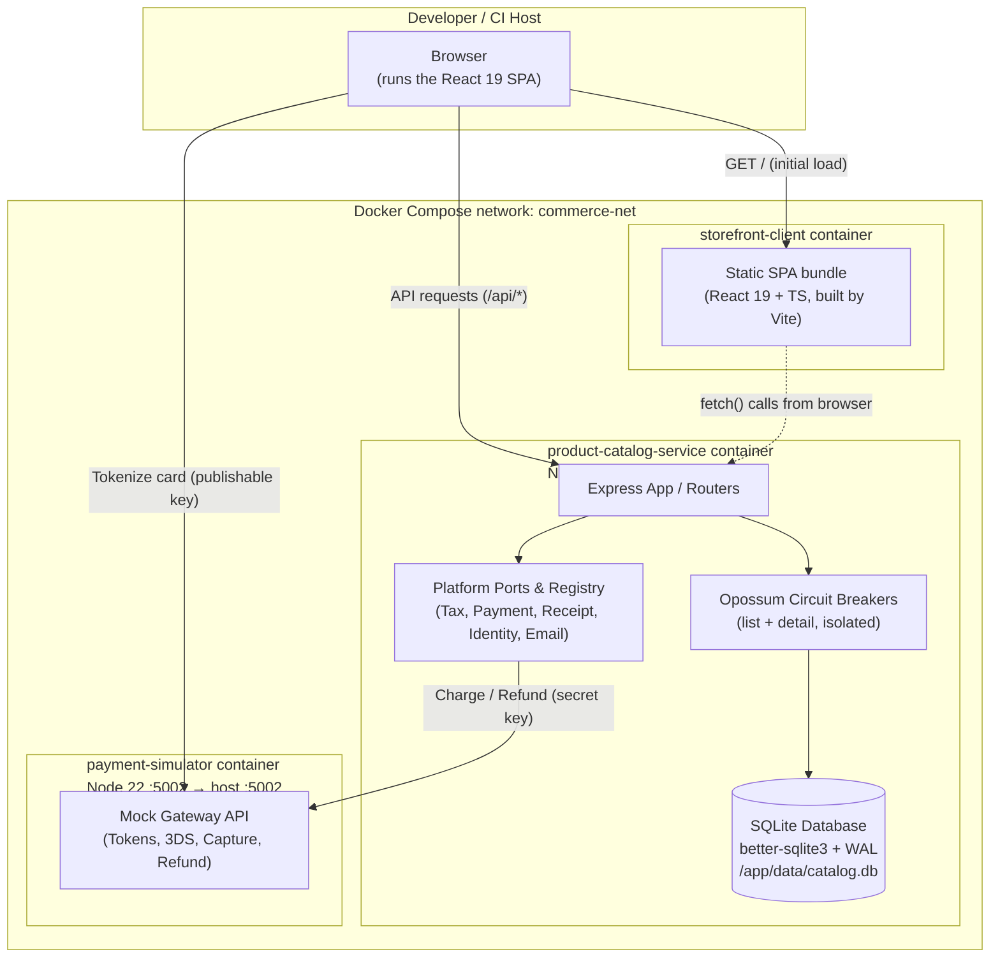
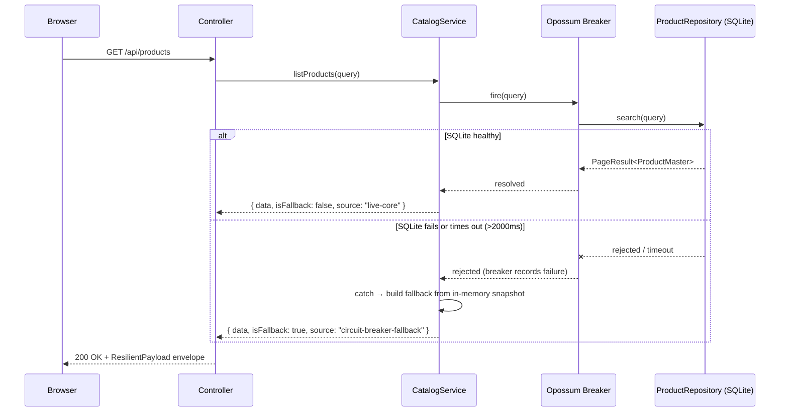
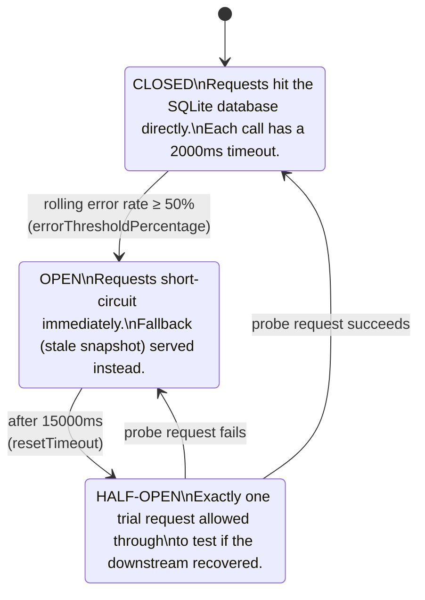
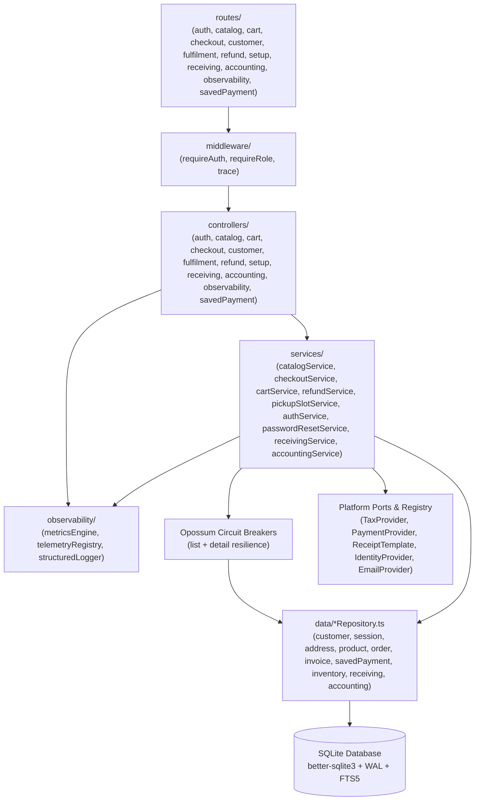
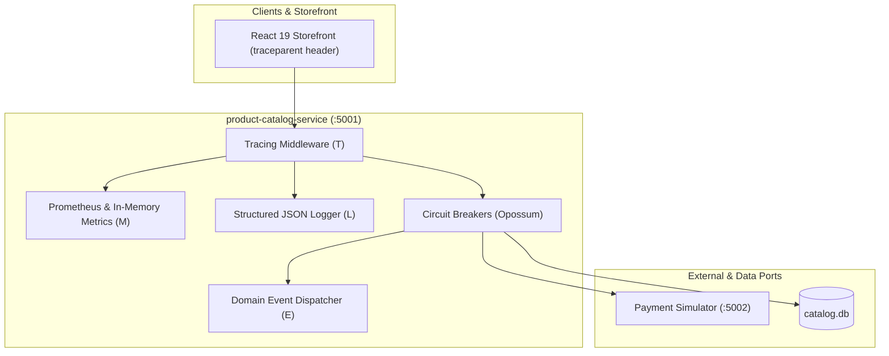

# Application Architecture

## Container Topology

Three independently deployable services, orchestrated by Docker Compose,
communicating over HTTP with clean separation of concerns:

1. **`storefront-client`** (Port 3000 / dev 5173): React 19 + TypeScript SPA built with Vite and served by Nginx.
2. **`product-catalog-service`** (Port 5001): Core Express API with SQLite database (`better-sqlite3`), Opossum circuit breaker, per-store inventory, and region platform modules.
3. **`payment-simulator`** (Port 5002): Local mock payment gateway offering browser-side tokenization with publishable keys and server-side authorizations, captures, and refunds with secret keys.

**Why the browser tokenizes directly with the payment gateway:** card numbers never touch the shop backend (`product-catalog-service`), fulfilling PCI-DSS compliance standards. The storefront client receives a one-time payment token from `payment-simulator` and submits only the token to `POST /api/checkout`.

## End-to-End Request Flow

## Circuit Breaker State Machine

This is the resilience mechanism the whole system is built to demonstrate. Configuration lives in `product-catalog-service/src/services/catalogService.ts`.

Every transition is logged with a formatted timestamp via `src/utils/logger.ts` — this is the same signal an operator would watch in production logs or a metrics dashboard, and it's asserted in automated tests (`testcase/tests/circuit-breaker.test.ts`).

## Layered Backend Design

Each layer strictly depends on the layer beneath it:
- **Routes & Middleware**: URL routing, token validation (`requireAuth`), role authorization (`requireRole`), and W3C trace propagation (`traceMiddleware`).
- **Controllers**: HTTP request unwrapping, payload validation, and `ResilientPayload` packaging.
- **Services**: Business rules, tax computation, payment provider orchestration, stock movements, accounting analytics, and circuit breaker fallbacks.
- **Observability**: Metrics collection (`metricsEngine`), real-time telemetry event bus, structured logging, and health readiness probes.
- **Platform**: Pluggable ports for region rules, payment gateways, tax calculation, and identity providers.
- **Repositories**: Direct SQL queries using `better-sqlite3` prepared statements and indexed queries.

## Observability & Telemetry Architecture (MELT)

The system implements enterprise-grade **MELT** capabilities for end-to-end monitoring and resilience inspection:

1. **Metrics (M)**: Real-time Prometheus metrics at `GET /metrics` and `/api/observability/metrics` tracking HTTP request throughput, p50/p95 latency histograms, circuit breaker trip frequency, SQLite query duration, and active checkout conversions.
2. **Events (E)**: Structured domain events (`ORDER_PLACED`, `PAYMENT_CAPTURED`, `INVOICE_ISSUED`, `GRN_RECORDED`, `STOCK_TRANSFERRED`, `REFUND_DISPATCHED`).
3. **Logs (L)**: Structured JSON log envelopes containing timestamp, trace IDs, request IDs, customer IDs, and log level.
4. **Traces (T)**: W3C `traceparent` and `x-request-id` header propagation across frontend and backend services.
5. **Health Probes**: Granular endpoints for orchestrators:
   - `GET /health/live` (Liveness)
   - `GET /health/ready` (Readiness)
   - `GET /health/db` (Database connectivity & WAL integrity)
   - `GET /health/circuit-breaker` (Opossum breaker states)
