# Database Architecture

## Persistence Model

`product-catalog-service` uses **SQLite (`better-sqlite3`) with Write-Ahead Logging (WAL)** for robust, zero-latency in-process relational storage.

The database file resides at `STORE_DB_PATH` (default `/app/data/catalog.db` or `./catalog.db`).

Schema migrations are strictly versioned, linear, and positional via the `MIGRATIONS` array in `src/db/database.ts`:
- **`v1`**: Customers, sessions, and address book.
- **`v2`**: Product catalog, specifications, gallery images, configuration choices, and SQLite FTS5 search index.
- **`v3`**: Orders, order lines, and sequential invoices.
- **`v4`**: Saved payment methods, password reset tokens, and extended order statuses (`placed`, `packed`, `ready`, `collected`, `cancelled`, `refunded`).
- **`v5`**: Per-store inventory (`store_inventory`), sequential Goods Receipt Notes (`goods_receipts`, `goods_receipt_items`, `grn_sequences`), stock transfers (`stock_transfers`), and shrinkage/wastage adjustments (`stock_adjustments`).
- **`v6`**: Accounting ledger & financial analytics performance indices (`idx_orders_placed_status`, `idx_orders_store_placed`, `idx_order_lines_prod`, `idx_invoices_issued`). Real-time reporting engine for multi-store P&L, 12-month trends, product velocity, gross margins, and multi-state tax liabilities.

## Entity-Relationship Diagram

```mermaid
erDiagram
    CUSTOMERS ||--o{ SESSIONS : has
    CUSTOMERS ||--o{ ADDRESSES : has
    CUSTOMERS ||--o{ SAVED_PAYMENT_METHODS : saves
    CUSTOMERS ||--o{ PASSWORD_RESET_TOKENS : requests
    CUSTOMERS ||--o{ ORDERS : places
    ORDERS ||--|{ ORDER_LINES : contains
    ORDERS ||--o| INVOICES : generates
    ORDERS ||--o{ REFUNDS : has
    PRODUCTS ||--o{ PRODUCT_SPECIFICATIONS : has
    PRODUCTS ||--o{ PRODUCT_GALLERY_IMAGES : has
    PRODUCTS ||--o{ CONFIGURATION_OPTIONS : has
    CONFIGURATION_OPTIONS ||--o{ CONFIGURATION_CHOICES : has
    PRODUCTS ||--o{ ORDER_LINES : referenced_by
    PRODUCTS ||--o{ STORE_INVENTORY : tracked_in
    PRODUCTS ||--o{ GOODS_RECEIPT_ITEMS : received_in
    PRODUCTS ||--o{ STOCK_TRANSFERS : transferred_in
    PRODUCTS ||--o{ STOCK_ADJUSTMENTS : adjusted_in
    GOODS_RECEIPTS ||--|{ GOODS_RECEIPT_ITEMS : contains

    CUSTOMERS {
        text id PK
        text email UK
        text password_hash
        text first_name
        text last_name
        text phone
        text preferred_store_id
        text role "customer | store-manager | admin"
        text status "active | anonymized"
        int failed_login_attempts
        timestamptz locked_until
    }

    ADDRESSES {
        text id PK
        text customer_id FK
        text kind "shipping | billing"
        int is_default
        text street1
        text city
        text region
        text postal_code
        text country
    }

    SAVED_PAYMENT_METHODS {
        text id PK
        text customer_id FK
        text token_ref
        text brand
        text last4
        int exp_month
        int exp_year
        int is_default
    }

    PRODUCTS {
        text id PK
        text name
        text brand
        text category
        text subcategory
        int price_minor
        char3 currency
        int stock
        int snap_eligible
        int is_weekly_find
    }

    STORE_INVENTORY {
        text store_id PK
        text product_id PK
        int stock
        int reserved
        int unit_cost_minor
        int low_stock_threshold
        timestamptz updated_at
    }

    GOODS_RECEIPTS {
        text id PK
        text grn_number UK
        text store_id
        text supplier
        text po_reference
        text status "draft | received | cancelled"
        int total_cost_minor
        text received_by
        timestamptz received_at
        text notes
    }

    GOODS_RECEIPT_ITEMS {
        text id PK
        text grn_id FK
        text product_id FK
        int quantity
        int unit_cost_minor
        text batch_number
        text expiry_date
        timestamptz created_at
    }

    STOCK_TRANSFERS {
        text id PK
        text transfer_number UK
        text from_store_id
        text to_store_id
        text product_id FK
        int quantity
        text status "pending | completed | cancelled"
        timestamptz created_at
        timestamptz completed_at
    }

    STOCK_ADJUSTMENTS {
        text id PK
        text store_id
        text product_id FK
        int quantity_delta
        text reason "shrinkage | damage | expired | audit"
        text adjusted_by
        timestamptz created_at
    }

    ORDERS {
        text id PK
        text customer_id FK
        text store_id
        char3 currency
        int subtotal_minor
        int tax_minor
        int total_minor
        text status "placed | packed | ready | collected | cancelled | refunded"
        text payment_status "pending | authorized | captured | refunded"
        text pickup_window_start
        text pickup_window_end
    }

    ORDER_LINES {
        text id PK
        text order_id FK
        text product_id FK
        int quantity
        int unit_price_minor
        int tax_minor
    }

    INVOICES {
        text id PK
        text order_id FK
        text store_id
        text number UK
        int total_minor
        timestamptz issued_at
    }

    REFUNDS {
        text id PK
        text order_id FK
        text credit_receipt_number UK
        int amount_minor
        text reason
        timestamptz created_at
    }
```

## Catalog FTS5 Search & Facet Engine

The grocery catalog uses SQLite's **FTS5 full-text search extension** with Porter stemming and prefix matching:
- Search queries match on product `name`, `brand`, `category_name`, `subcategory_name`, and `description`.
- Facets (departments, subcategories, brands, dietary tags, ratings, price ranges, SNAP eligibility) are calculated using disjunctive subqueries so selecting a category or brand does not collapse its own facet counts.
- Degraded mode fallback serves a static in-memory snapshot (`warmCatalogSnapshot`) when database failures or timeouts occur.

## Key Design Decisions

1. **Integer Minor Units (Cents)**: All financial amounts (`price_minor`, `subtotal_minor`, `tax_minor`, `total_minor`, `unit_price_minor`, `unit_cost_minor`, `total_cost_minor`) are stored as 64-bit integers to prevent floating-point rounding errors.
2. **Immutable Snapshots**: Orders and invoices snapshot unit prices, tax rates, applied fees, and store state at the moment of placement. Updates to product master data or customer profile do not alter historical records.
3. **PCI-style data handling**: Saved payment methods store only token references (`token_ref`), brand, last 4 digits, and expiration dates. Full card numbers and CVVs are never written to disk or logged.
4. **Anonymization over Hard Deletion**: Account deletion (`DELETE /api/customers/me`) anonymizes PII (clears phone, names, addresses) while preserving orders and invoices required for tax and audit compliance.
5. **Weighted Average Costing ($WAC$)**: Material intake recalculates per-store average unit cost dynamically on receipt: `(oldStock * oldWac + receivedQty * unitCost) / (oldStock + receivedQty)`.
6. **Sequential Legal Document Numbering**: Zero-gap sequence counters (`invoice_sequences`, `grn_sequences`) guarantee strict sequential audit numbers per store (`INV-STORE-XXXX`, `GRN-STORE-XXXX`).
