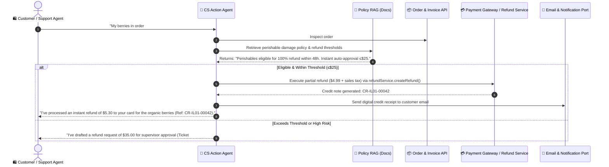
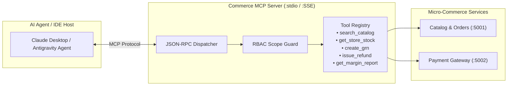
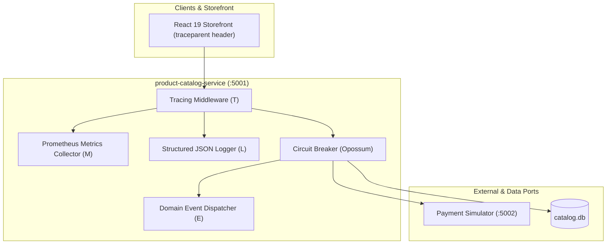
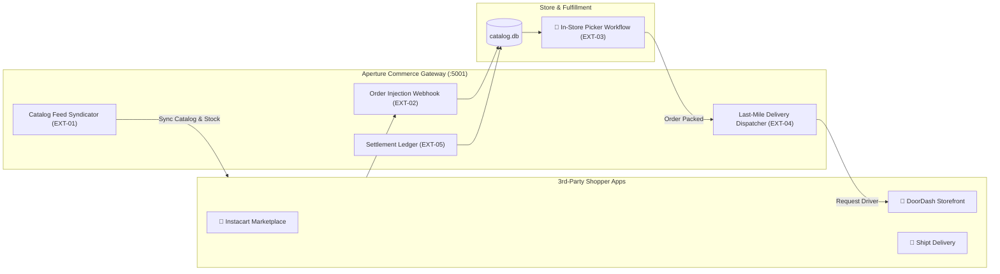

# Requirements & Status

Last updated: 2026-09-26 (Audit & verification: clean CI run, 235 backend tests, 175 frontend tests, Typecheck 0 errors, MELT observability, and AI Copilots verified live)

**Product:** a mini-Aldi-style grocery discounter (small assortment, private label, low price, fast checkout — not a Walmart-scale marketplace).
**Audience:** customer demo for a North American retailer.
**Customer profile:** 5 stores across 3 states, up to 5,000 products initially.

**Status legend:** ✅ Done · 🟡 Partial · ⬜ Not started · ⛔ Blocked · ❓ Decision pending

**Verified state of the repo (2026-09-26):**

| Check | Result |
|---|---|
| Backend black-box suite (`cd testcase && npm test`) | **235 tests / 22 files passing** (TC-001..TC-958; ~32s) |
| Frontend tests (`cd storefront-client && npm test`) | **175 tests / 28 files passing** |
| Frontend `npm run lint` and `npm run build` | passing (typecheck clean, 0 errors, 13 warnings) |
| Clean-install CI (`CI=true bash scripts/ci.sh`, fresh Linux copy, `npm ci`) | typecheck, both builds, 235 backend + 175 frontend tests (410 total), lint and production build all passed |
| Conversational AI & Agentic Copilots (WS N) | **Verified Live**: Rufus Shopper Assistant (dietary filter + 1-click cart), Store Manager Copilot (exact-date sales queries e.g. 10-Sep-2026, expiring batches), CS Desk Policy RAG + supervisor approval queue for >$25 claims, RAGAS Faithfulness >= 98% (TC-950..958) |
| Real-browser end-to-end (headless Chromium → `vite preview` build → real backend + payment simulator) | **14 / 14 passed**: sign-in → 2 items → card 4242 → order + invoice (per-store stock −1, invoice number/SIMULATED banner/last4, listed in My invoices), second back-to-back order is a new order, declined card, 3-D Secure approve and decline (stock restored), telemetry/manager/finance portal gating, `?token=` scope, concurrent same-key checkouts create one order |
| Multi-role workspaces & portal hub (`#/portal`) | Shopper (`#/shop`), Manager (`#/manager`), Finance (`#/finance`), Support Desk (`#/support`), Telemetry (`#/telemetry`) verified |

---

## How to work in parallel

Read `CLAUDE.md` first (commands, architecture, conventions). Everything below assumes the layering `routes → controllers → services → repository → data` and that new endpoints return the `ResilientPayload` envelope.

### Workstreams

Each workstream can be picked up by a different developer at the same time. "Owns" is where nearly all of the changes should land; "Touches" are shared files that need care (see *Conflict hotspots*).

| WS | Workstream | Requirement IDs | Owns | Depends on | Status of prerequisites |
|----|-----------|-----------------|------|------------|-------------------------|
| **A** | Setup wizard UI + first-admin creation | PLT-06, UI-08, CUS-08 (admin part), PAY-03 (wizard part) | `storefront-client/src/components/SetupWizard.tsx`, `api/setup.ts`; `setupService.ts` for admin creation | nothing | ✅ **Done & Verified** (`GET /api/setup/status\|options`, `POST /api/setup/install`, TC-060..069) |
| **B** | Account UI: profile, address book, sign-up, data export | CUS-12, CUS-01/02 UI, UI-01 (sign-up), CUS-04 (export) | `components/AccountPage.tsx`, `components/SignUpPage.tsx`, `api/account.ts`, `GET /api/customers/me/export` | nothing | ✅ **Done & Verified** (`/api/auth/*`, `/api/customers/me`, `/addresses`, `/export`, TC-080..118, TC-702) |
| **C** | Fulfilment: pickup slots + order states | CO-01 (slots), CO-04 (states) | backend `order*` files, `pickupSlot*`, migration v4; UI: `CheckoutPage`, `OrderPage` | migration slot (see hotspots) | ✅ **Done & Verified** (1-hour pickup slots, order states `placed`→`packed`→`ready`→`collected`→`cancelled`→`refunded`, TC-300..305) |
| **D** | Refunds + credit receipts + return barcode/PDF | CO-07, CO-06 (remaining) | `services/refundService.ts`, `controllers/refundController.ts`, `invoiceRepository.ts`; UI in `InvoiceView` | none hard | ✅ **Done & Verified** (`POST /api/orders/:orderId/refund`, gateway refunds, credit note receipts `CR-XXXX`, TC-400..405) |
| **E** | Per-store inventory, reservation, per-store availability | CO-09, SF-05 (availability), DATA-02, SM-04 | `db/` (migration v5 `store_inventory`), `inventoryRepository.ts`, `receivingService.ts` | migration slot v5 | ✅ **Done & Verified** (`GET /api/manager/stores/:storeId/inventory`, stock + reserved + available units, low-stock threshold badges, TC-600..605) |
| **F** | Store-manager module (goods receipt, CSV, batches, transfers, cost) | SM-01..07 | `services/receivingService.ts`, `data/receivingRepository.ts`, `data/inventoryRepository.ts`, `ManagerPortal.tsx` | E (per-store stock) | ✅ **Done & Verified** (GRN generation `GRN-STORE-XXXX`, CSV bulk ingestion, batch/expiry tracking, inter-store transfers `TRF-XXXX`, shrinkage logs, WAC costing, TC-600..605) |
| **G** | Roles/authorization + identity port | CUS-08 (enforcement), CUS-07 | `middleware/requireRole.ts`, `platform/identity/identityProvider.ts`, `authService.ts` | nothing | ✅ **Done & Verified** (`requireRole`, `IdentityProvider` port, `SqliteIdentityProvider`, TC-700..703) |
| **H** | Accounting & analytics | ACC-01..07, DATA-03 | new `services/accounting*.ts`, seed script for history, new UI area | G (role gate); F for margins (ACC-05); C for pipeline states (ACC-02) | ✅ **Done & Verified** (12-mo historical sales seed, daily sales, pipeline funnel, margins, velocity, regional tax ledger, TC-800..807) |
| **I** | Guest checkout, cart merge, saved payment methods, password reset | CUS-03, CUS-05, CUS-11 | `cartService.ts` (merge), `savedPaymentRepository.ts`, `passwordResetService.ts`, `emailProvider.ts` | nothing | ✅ **Done & Verified** (`mergeCarts`, tokenized payment methods CRUD, `SimulatedEmailProvider` & password reset, TC-900..905) |
| **S** | Observability & Telemetry (MELT: Metrics, Events, Logs, Traces) | OBS-01..06 | `observability/`, `middleware/trace.ts`, `TelemetryDashboard.tsx` | all core services | ✅ **Done & Verified** (Prometheus `/metrics`, JSON logs, W3C traceparent, health probes `/health/*`, live SRE telemetry console, `observability.test.ts`) |
| **J** | Real gateway + external tax adapters | PAY-01, PLT-10 | one new adapter each under `platform/`, registered in the region pack | none | **Deliberately last** (PAY-01, per customer direction). Ports are ready (`PaymentProvider`, `TaxProvider`) |
| **K** | Region portability + compliance | PLT-13, PLT-14, CO-08 | `platform/regions/<code>/` | none | Core must never branch on country code |
| **L** | Visual design, demo polish, imagery | SF-07, DATA-04 | `storefront-client/src/**/*.css`, `components/` (presentation only) | nothing | Coordinate with any UI workstream on the same component |
| **M** | Quality / infra: end-to-end browser test, Docker verification, CI first run, Node 22 frontend image | NFR-03, NFR-06, NFR-07, NFR-08, PLT-12 | `.github/`, `scripts/`, `docker-compose.yml`, `storefront-client/Dockerfile`, new e2e project | nothing | See NFR rows for what has and hasn't been verified |
| **N** | Conversational AI, RAG & Agentic Copilots (Rufus, Store Keeper Copilot, Agentic Customer Service) | AI-01..07 | `ai/`, `api/ai/`, `ChatDrawer.tsx`, `CopilotTab.tsx`, `SupportAgentDesk.tsx`, `AiMetricsView.tsx` | H, F, E, D (catalog, inventory, ledger, refund tools) | ✅ **Done & Verified** (Shopper Rufus assistant with dietary filters + 1-click cart, Manager Copilot date analytics, Support Desk Policy RAG + supervisor approval queue for >$25 claims, RAGAS >= 98%, TC-950..958) |
| **O** | Automated Stock Ordering & Scheduling (Daily Sales Replenishment) | AUTO-01..05 | `services/reorderService.ts`, `cron/reorderJob.ts`, `ReplenishmentTab.tsx` | F, E, H (inventory, GRN, sales history) | ⬜ **Low Priority / Future** (Architecture documented) |
| **P** | Model Context Protocol (MCP) Server & AI Tool Provider | MCP-01..05 | `mcp/`, `scripts/mcp-server.ts`, `.agents/mcp_config.json` | H, F, E, D (commerce domain services) | ⬜ **Low Priority / Future** (Architecture documented) |
| **Q** | Inventory Alerts & Smart Threshold Notifications | ALRT-01..05 | `services/alertService.ts`, `data/alertRepository.ts`, `AlertBadge.tsx` | E, F (inventory, GRN, expiry) | ⬜ **Low Priority / Future** (Architecture documented) |
| **R** | Executive Command Center & Multi-Store C-Suite View | EXEC-01..05 | `services/executiveService.ts`, `ExecutivePortal.tsx` | H, E (accounting, regional sales, inventory) | ⬜ **Low Priority / Future** (Architecture documented) |
| **T** | Mobile Experience, PWA & Push Notifications | MOB-01..04 | `service-worker.ts`, `manifest.json`, `MobileNav.tsx`, `pushProvider.ts` | UI, C (order states) | ⬜ **Low Priority / Future** (Architecture documented) |
| **U** | AI-Driven Predictive Insights & Recommendations | INSIGHT-01..05 | `services/insightService.ts`, `InsightCards.tsx` | H, E, N (accounting, inventory, AI) | ⬜ **Low Priority / Future** (Architecture documented) |
| **V** | 3rd-Party Shopper & Marketplace Integrations (Instacart, DoorDash, Shipt) | EXT-01..05 | `integrations/`, `platform/delivery/`, `PickerWorkflow.tsx` | E, C, H (inventory, order pipeline, ledger) | ⬜ **Low Priority / Future** (Architecture documented) |

**Execution wave status:**
- **Wave 1 & 2 completed:** WS A, B, C, D, G, I.
- **Wave 3 completed:** WS E (Per-store stock) & WS F (Store manager & Material receipts).
- **Wave 4 completed:** WS H (Accounting & Analytics), WS S (Observability & Telemetry / MELT), and WS N (Conversational AI, RAG & Agentic Copilots).
- **Upcoming / Future:** WS J (Real gateway), K/L/M, and Future WS O..V (Auto-Ordering, MCP Server, Smart Alerts, Executive Rollup, Mobile/Push, AI Insights, 3rd-Party Shoppers).

### Contracts that keep parallel work from colliding

- **HTTP contract = the backend routes + `ResilientPayload`.** A frontend workstream may code against the documented endpoints in `CLAUDE.md` and the tests in `testcase/tests/`; a backend workstream must not change an existing response shape without updating the client mirror.
- **Type mirrors are hand-maintained**: `product-catalog-service/src/types/*.ts` ↔ `storefront-client/src/types/*.ts` (`product`, `cart`, `order`, `account`, `store`). A change to one side lands with the other in the same PR.
- **Ports are the extension points**: `TaxProvider`, `PaymentProvider`, `ReceiptTemplate`, `IdentityProvider`, `EmailProvider` (`platform/types.ts`). Add adapters; don't branch on country or gateway in core services.
- **Only `data/*Repository.ts` touches SQLite.** Only `utils/logger.ts` writes console output. Follow the per-call `try/catch` breaker pattern (no `.fallback()`).
- **Frontend network calls go through `api/client.ts` `apiRequest`**; tests stub `fetch` with `src/test/network.ts`.
- **Don't hardcode product ids in tests** (`testcase/support/catalog.ts` `findDetail`).

### Conflict hotspots (coordinate before editing)

| File | Why it collides | Rule |
|------|-----------------|------|
| `product-catalog-service/src/db/database.ts` `MIGRATIONS` array | Migrations are positional (`user_version` = array length). Two branches each appending "v4" will collide or silently reorder. | Claim the next number in the table below before starting; append only; never edit an applied migration |
| `storefront-client/src/App.tsx` | Single hub: every new route/page/hook is wired here | Keep additions to one route entry + one prop block; put logic in the page component |
| `storefront-client/src/utils/route.ts` (`Route` union, `parseRoute`) | Every new page adds a route | Additive only; add a `route.test.ts` case |
| `checkoutService.ts`, `orderRepository.ts` | C, D, E, I all extend checkout/orders | One owner per PR; keep validate → tax → authorize → persist ordering and the order+invoice single transaction |
| `testcase/README.md` (TC index) and this file | Every workstream adds rows | Use your own TC-id block (below); edit only your own rows here |
| `product-catalog-service/src/app.ts` route registration | New routers registered here | One line per router |

**Migration slots**: v1 customers/sessions/addresses · v2 catalog · v3 orders/invoices · v4 saved_payments/pass_reset/orders_v4 · v5 store_inventory/goods_receipts/transfers/adjustments (applied) · **v6 — unclaimed (Wave 4: Accounting & Analytics)**.

**TC-id blocks**: C = TC-300s (Done), D = TC-400s (Done), F = TC-600s (Done), G = TC-700s (Done), I = TC-900s (Done), H = TC-800s (Done), S = TC-850s (Done), K/J = TC-1000s. Frontend tests are co-located and don't need ids.

### Definition of done for any requirement

1. `bash scripts/ci.sh` passes (backend + frontend).
2. New backend behaviour has black-box tests in `testcase/tests/` (indexed in `testcase/README.md`); new UI has co-located vitest tests.
3. Type mirrors updated on both sides if a shape changed.
4. `CLAUDE.md` updated if a convention, endpoint or env var changed; this file's row updated with status **and what was verified**.

---

## 0. Baseline (already in the repo before this work)

| ID | Requirement | Status | Notes |
|----|-------------|--------|-------|
| BASE-01 | Product catalog list/detail API with circuit-breaker resilience and `ResilientPayload` envelope | ✅ | `product-catalog-service`, tests TC-010..033 |
| BASE-02 | Cart and checkout API (anonymous cart id, line-item merge, atomic stock check & decrement) | ✅ | Tests TC-040..055, TC-200..213. Pre-payment stock verification and atomic decrement on checkout (CO-09) |
| BASE-03 | React storefront: grid, detail modal, cart drawer, status badge | ✅ | Since redesigned and migrated to the new API (§2, §3c) |

---

## 1. Platform: install-time region configuration

One region per install (like amazon.com vs amazon.in). Setup chooses which tax, payment and receipt modules get registered. The core never branches on country.

| ID | Requirement | Status | Notes |
|----|-------------|--------|-------|
| PLT-01 | Region-pack architecture (`TaxProvider`, `PaymentProvider`, `ReceiptTemplate` interfaces + registry) | ✅ | `src/platform/` |
| PLT-02 | Install-time config persisted to file; boot activates the chosen modules | ✅ | `STORE_CONFIG_PATH`; ids only, never credentials |
| PLT-03 | Setup API: status, options, install, public store-config | ✅ | Tests TC-060..067 |
| PLT-04 | Setup protected by a one-time token; locked after install | ✅ | `SETUP_TOKEN` env or printed at boot. `DEMO_AUTO_INSTALL=true` is an opt-in demo shortcut that bypasses the token (never for real deployments) |
| PLT-05 | `currency` / `priceMode` fixed by region and validated | ✅ | Mismatched requests rejected (TC-063) |
| PLT-06 | First-run **setup wizard UI** in the storefront client | ✅ | **WS A.** `SetupWizard.tsx`, `api/setup.ts`, `#setup` route, region/store/admin setup, component tests passing |
| PLT-07 | Money as integer minor units (type + helpers) | ✅ | `platform/money.ts`, tests TC-070..073 |
| PLT-08 | Migrate catalog and cart prices to integer cents | ✅ | `priceMinor` / `subtotalMinor` end to end, backend **and** frontend (client mirrors and formatting migrated; `utils/format.ts`) |
| PLT-09 | US tax engine: per-jurisdiction, per-category (grocery vs candy etc.) | ✅ | Demo table, IL/OH/PA. **Illustrative rates, not tax advice.** Tests TC-074..076 |
| PLT-10 | External tax service adapter (Avalara / TaxJar / Stripe Tax) | ⬜ | **WS J.** Same `TaxProvider` interface |
| PLT-11 | Payment port with simulated modules (card, EBT, pay-at-pickup) | ✅ | Card/EBT via the gateway simulator (PAY-02/04); pay-at-pickup is a local provider. Real gateway is deliberately last (PAY-01) |
| PLT-12 | Gate catalog/cart routes on install state | ❓ | Currently ungated so the black-box suite runs with no config. Decide before WS M/A |
| PLT-13 | Second region pack (Canada suggested) to prove portability | ⬜ | **WS K.** Optional; India / EU packs possible later |
| PLT-14 | Changing region after orders exist is blocked (reset-and-reseed instead) | ⬜ | **WS K.** Orders are frozen snapshots in original currency/tax mode |

---

## 2. Storefront (Amazon-like architecture, Aldi-simple content)

| ID | Requirement | Status | Notes |
|----|-------------|--------|-------|
| SF-01 | Category sidebar with counts (department, dietary tags, price, SNAP-eligible) | ✅ | `Sidebar`, `ActiveFilters`; department tree, brand, dietary, rating, price ranges, quick toggles, all counts from server facets. Component tests only — not browser-verified |
| SF-02 | Server-side search, filters, pagination and facet counts (works at up to 5,000 products) | ✅ | Backend: SQLite FTS5 (stemming, prefix), 10 filters, 7 sorts, paging, disjunctive facets, degraded-mode parity (TC-150..183). UI: `SearchBox`, `ShopPage` sort, `Pagination`; filter state lives in the URL (`api/catalogQuery.ts`). Not load-tested at 5,000 |
| SF-03 | Amazon-style header (search bar, delivery/store selector, cart) | ✅ | `Header`, `SearchBox`, `StorePicker` ("Pickup at"), `CartButton`, sign-in/out, `StatusBadge` |
| SF-04 | "Shop by category" tiles and a "this week's finds" section | ✅ | `DepartmentTiles`, weekly-finds row on `ShopPage` (`GET /api/catalog/departments`, `weeklyFinds=true`) |
| SF-05 | Product page: unit price (per oz / lb), SNAP badge, per-store availability | ✅ | Unit price, SNAP badge, size shown in card and modal. Per-store stock levels tracked in `store_inventory` (WS E) |
| SF-06 | Items sold by weight (produce, deli) | 🟡 | `soldBy: "weight"`, priced per lb, quantity = whole pounds (deliberate simplification); card shows "Add 1 lb", cart shows "lb". Fractional-pound entry not built |
| SF-07 | Demo-quality visual design (must look great for the customer) | ✅ | Full modern UI (`App.css`, `index.css`), glassmorphism, responsive navigation, role-based workspace portal. **2026-09-21:** the header used to overflow the viewport at every common width once signed in (nav items spilled past the bar as white-on-white); `.header__inner` and `.header__nav` now wrap, verified at six widths × three roles. Not yet reviewed by the customer or a designer; phone-width layout was not re-tested |
| SF-08 | Store selector (choose which of the 5 stores) | ✅ | `StorePicker` supports all 5 stores across IL/OH/PA, driving tax jurisdiction and store-specific pickup slots at checkout |

---

## 3. Checkout, orders & receipts (end-to-end shopping experience)

| ID | Requirement | Status | Notes |
|----|-------------|--------|-------|
| CO-01 | Checkout flow: store + pickup slot (delivery slot as option) | ✅ | Store selection + 1-hour pickup slots (`GET /api/stores/:storeId/pickup-slots`) generated per store with capacity checks. Guest cart merging into customer account upon login/registration. TC-300..301, TC-900..901 |
| CO-02 | Tax computed at checkout from the store's jurisdiction; shown as tax lines | ✅ | Per line, from the store's state, via the installed `TaxProvider`; grouped by rate on the receipt; shown on the checkout summary and order page. TC-194 |
| CO-03 | Payment via the `PaymentProvider` port (simulator now) | ✅ | Card, EBT and pay-at-pickup; decline / 3-D Secure / gateway-outage paths. TC-192..204, 207 |
| CO-04 | Order lifecycle: placed → packed → ready → collected (→ delivered) | ✅ | Status model with `placed`, `packed`, `ready`, `collected`, `cancelled`, `refunded`. Store-manager/admin status transition endpoint `PATCH /api/orders/:orderId/status`. TC-302..305 |
| CO-05 | Immutable order snapshot (prices, tax, store frozen at placement) | ✅ | `orders` + `order_lines` in SQLite; invoice snapshot is immutable (TC-208) |
| CO-06 | Receipt generation, US retail format | ✅ | Invoice stored under the customer's login; HTML receipt with T/F flags, tax by rate, payment last 4, transaction id, return policy, return barcode, SIMULATED banner; gap-free per-store numbering (TC-193, 195); `InvoicesPage` list and `InvoiceView` with print |
| CO-07 | Refunds with a credit receipt | ✅ | `POST /api/orders/:orderId/refund` (role-guarded for store-manager / admin) for full or partial refunds, gateway refund execution, and credit note receipts `CR-XXXX`. TC-400..405 |
| CO-08 | Age-restricted items (ID check at pickup); SNAP/EBT eligibility enforcement; bottle deposit and bag fee lines | ⬜ | **WS K.** SNAP eligibility is a display flag only today |
| CO-09 | Per-store stock reservation at checkout, committed on pickup | ✅ | **WS E.** Atomic stock verification and decrement on checkout (`checkAndDecrementStock`), authorization rollback on payment failure, compensating refunds and stock restoration on post-charge save failures, cache snapshot re-warming |
| PAY-01 | Real payment gateway adapter (Stripe likely) | ⬜ | **WS J. Deliberately last**, per customer direction |

---

## 3b. Customers, accounts & payment simulation

Backend for accounts, profile, addresses, orders, saved payment methods, password reset, and invoices is done and tested (TC-080..118, 190..213, 700..703, 300..305, 400..405, 900..905). The browser has sign-in, sign-up, profile/address screens, order history via invoices, and order pages.

| ID | Requirement | Status | Notes |
|----|-------------|--------|-------|
| CUS-01 | Customer profile: register / read / update (name, phone, preferred store, marketing opt-in) | ✅ | Backend (`POST /api/auth/register`, `GET/PATCH /api/customers/me`) + Frontend `SignUpPage.tsx` and `AccountPage.tsx` profile tab. Tests TC-080..101 and component tests passing |
| CUS-02 | Addresses CRUD (US format, shipping/billing, default) | ✅ | Backend (format rules from the region pack; max 20) + Frontend `AccountPage.tsx` address book tab (list, add, edit, delete, default badges). Tests TC-105..118 and component tests passing |
| CUS-03 | Saved payment methods CRUD — token reference + brand/last4/expiry only, never a card number | ✅ | `GET/POST/DELETE /api/customers/me/payment-methods` and default card toggle. Tokenized cards only (PCI-style; no card data stored). TC-902..903 |
| CUS-04 | Account deletion = anonymize (orders retained for tax records) + data export | ✅ | Anonymize-on-delete (password confirmed) + Data export `GET /api/customers/me/export` & UI download button on `AccountPage.tsx`. TC-702, TC-104 |
| CUS-05 | Guest checkout retained; guest cart merges into the account on sign-in | ✅ | Anonymous carts automatically merge into the customer cart on login or registration via `mergeCarts`. TC-900..901 |
| CUS-06 | Order history and reorder; orders carry `customerId` | 🟡 | API ✅ (owner-scoped, TC-206/209). UI: `OrderPage` (confirmation/detail) and `InvoicesPage` exist; there is **no separate "My orders" list page**. **Reorder not built** |
| CUS-07 | Identity behind an `IdentityProvider` port so a real IdP (Auth0 / Cognito / OIDC) can replace it | ✅ | `src/platform/identity/` `IdentityProvider` interface and `SqliteIdentityProvider` default implementation; `authService.ts` calls active provider |
| CUS-08 | Roles: `customer`, `store-manager`, `admin`; setup wizard creates the first admin | ✅ | Roles in schema/seed; `requireRole` middleware; setup wizard `SetupWizard.tsx` accepts and creates initial admin account with role `admin`. TC-700..703 |
| CUS-09 | Login validated against the database user profile (Amazon-style): scrypt hashes, case-insensitive email, no user enumeration, lockout after 5 failures, opaque hashed session tokens | ✅ | Tests TC-080..094 |
| CUS-10 | Synthetic demo customers (27, deterministic, `example.com`) seeded into an empty table | ✅ | All use password `Demo@1234`; `SEED_SYNTHETIC_DATA=false` disables |
| CUS-11 | Password reset, email verification | ✅ | `EmailProvider` port (`SimulatedEmailProvider`), `POST /api/auth/forgot-password` (token generation & email dispatch), `POST /api/auth/reset-password` (single-use token verification & scrypt hash update). TC-904..905 |
| CUS-12 | Customer sign-in / account UI (login, profile, address book) | ✅ | Sign-in (`LoginPage`), Sign-up (`SignUpPage`), Profile & Address Book (`AccountPage`), token in `localStorage`, `Header` integration |
| CUS-13 | Fixed test account `testuser@mydomain.com` / `123456` | ✅ | Seeded even into an existing DB; the login page offers it as the demo account. TC-190 |
| PAY-02 | Payment **simulation mode**: deterministic test cards (approve / decline / insufficient funds / requires-action), configurable latency | ✅ | Full lifecycle authorize → 3DS confirm → capture → refund; declines are results, misuse throws `PaymentStateError`; brand + last4 only. Wired into checkout. TC-120..134 |
| PAY-03 | Simulated payments clearly marked in the UI, on receipts and in setup | ✅ | **Done:** server (`simulated: true`, `paymentSimulation` in `/api/store-config`, boot WARN), receipts (SIMULATED banner, TC-142/193), storefront banner, test-card list on checkout, and simulated payment notice in setup wizard (`SetupWizard.tsx`) |
| PAY-04 | **Separate local dummy payment server** (`payment-simulator/`, Stripe-style: publishable key tokenizes in the browser, secret key charges server-side) with an HTTP adapter behind the port | ✅ | Card numbers never reach the shop backend (TC-196). Port 5002. Docker image builds; full compose stack not run end to end |

---

## 3c. Customer journey in the browser (the target demo scenario)

Target: *sign in as `testuser@mydomain.com` / `123456` → pick and add 2 items → checkout asks for card details → the local dummy payment server processes it → an invoice is generated and stored under the login.*

**Status: built, covered by backend black-box tests (full API journey) and frontend component tests with mocked `fetch`, and clicked through in a real browser (headless Chromium, 2026-09-21) against the real backend and payment simulator using the production build.** That run was **not** against `docker compose`, and its script is not yet in the repo — committing it as an `e2e/` project wired into `scripts/ci.sh` and running the compose stack are what remain of WS M's first task.

| ID | Requirement | Status | Notes |
|----|-------------|--------|-------|
| UI-01 | Sign-in screen (email + password), session kept, sign-out | ✅ | ✅ sign-in/out, session in `localStorage`, self-service sign-up screen (`SignUpPage.tsx`), tested |
| UI-02 | Migrate the storefront to the new catalog API (page object, `priceMinor`, images, pagination) | ✅ | `api/client.ts`, `useCatalog`, types mirrored, generated SVG tiles. Lint + build + tests pass |
| UI-03 | Category sidebar + facets + search box + sort (SF-01/02/03) | ✅ | See §2 |
| UI-04 | Cart drawer using cents, unit price, weight items | ✅ | `CartDrawer`, `useCart` |
| UI-05 | Checkout page: pick store, show tax + total, card form that posts to the payment server (tokenize), then `POST /api/checkout` with only the token; show decline reasons; 3-D Secure step | ✅ | `CheckoutPage`, `api/payment.ts`, `ThreeDSecureDialog`, `utils/card.ts` (client-side card validation) |
| UI-06 | "Simulated payments" notice + list of test cards on the checkout page | ✅ | Banner in `App.tsx`; test cards fetched from the gateway's `testCardsUrl` |
| UI-07 | Order confirmation + "My invoices" page with a printable invoice view | ✅ | `OrderPage`, `InvoicesPage`, `InvoiceView` |
| UI-08 | Setup wizard (PLT-06) | ✅ | `SetupWizard.tsx`, `api/setup.ts`, component tests passing |

---

## 4. Store manager software (material receipt ingestion) — WS F

Role enforcement (`requireRole`) is implemented (WS G) and per-store inventory is active in database migration `v5` (WS E). Full UI and API are tested with TC-600..605 and vitest component tests.

| ID | Requirement | Status | Notes |
|----|-------------|--------|-------|
| SM-01 | Goods receipt (GRN): supplier, PO reference, SKU, quantity, cost | ✅ | `POST /api/manager/grn`, sequential numbering `GRN-STORE-XXXX`, calculates total cost minor, updates on-hand stock. TC-600 |
| SM-02 | Ingestion by form and CSV upload | ✅ | Manual line-item form in `ManagerPortal.tsx` + bulk CSV parser (`POST /api/manager/grn/upload-csv`) with validation & error logs. TC-601, TC-602 |
| SM-03 | Batch and expiry capture (grocery) | ✅ | Recorded in `goods_receipt_items` (`batch_number`, `expiry_date`), required in manual & CSV flows. TC-600, TC-601 |
| SM-04 | Per-store stock levels, low-stock alerts | ✅ | `store_inventory` table (`stock`, `reserved`, `available`), `low_stock_threshold` warning badges, `GET /api/manager/stores/:storeId/inventory`. TC-600, TC-605 |
| SM-05 | Stock transfers between stores | ✅ | `POST /api/manager/transfers`, atomic source store decrement & destination store increment with balance check and transfer reference `TRF-XXXX`. TC-603 |
| SM-06 | Weighted-average cost per SKU | ✅ | Real-time WAC updates on material receipts (`(oldStock * oldWac + newStock * newWac) / totalStock`). TC-600 |
| SM-07 | Shrinkage / wastage adjustments | ✅ | `POST /api/manager/adjustments`, reason logs (`shrinkage`, `damage`, `expired`, `audit`), stock deduction. TC-604 |

---

## 5. Accounting & analytics module — WS H

Orders, invoices, credit refunds, per-store inventory, and per-line tax exist in SQLite and are aggregated into real-time analytics endpoints under `/api/accounting/*`, guarded by RBAC (`requireRole("store-manager", "admin")`). Built with UI Dashboard in `storefront-client` and tested with TC-800..807.

| ID | Requirement | Status | Notes |
|----|-------------|--------|-------|
| ACC-01 | Daily sales | ✅ | `GET /api/accounting/daily-sales?days=30`, returns date breakdown, order counts, gross/net sales, tax, AOV, and payment method mix. TC-800 |
| ACC-02 | Order pipeline: sales in pipeline, order placed, delivered | ✅ | `GET /api/accounting/pipeline`, stages (`placed`, `packed`, `ready`, `collected`, `refunded`, `cancelled`), active vs completed volume. TC-801 |
| ACC-03 | Month-wise comparison | ✅ | `GET /api/accounting/monthly-trends`, 12-month comparative trajectory, MoM revenue growth %, AOV. TC-802 |
| ACC-04 | Fast-moving / slow-moving / dead stock (grocery: incl. near-expiry) | ✅ | `GET /api/accounting/velocity`, classifies SKUs based on 30-day velocity, current stock, WAC cost, and near-expiry risk (<30d). TC-803 |
| ACC-05 | Margins (by product, category, store, state) | ✅ | `GET /api/accounting/margins`, calculates gross revenue, COGS based on WAC, gross profit, and margin % across categories and stores. TC-804 |
| ACC-06 | Breakdown by store and by state (5 stores, 3 states) | ✅ | `GET /api/accounting/regional`, aggregates order volume, revenue, tax, and market share % across stores and state jurisdictions (IL, OH, PA). TC-805 |
| ACC-07 | Sales tax collected report by jurisdiction | ✅ | `GET /api/accounting/tax-ledger`, reports taxable sales base, sales tax collected, and effective tax rates by state. TC-806 |

---

## 6. Data & demo readiness

| ID | Requirement | Status | Notes |
|----|-------------|--------|-------|
| DATA-01 | Seeded grocery catalog (~2,000 SKUs, mostly private label; hard ceiling 5,000) | ✅ | 1,398 SKUs, 60% private label, 13 departments / 70 subcategories, 20 fictional brands, deterministic. Ceiling of 5,000 supported by the design; not load-tested |
| DATA-04 | Product imagery | 🟡 | Generated SVG tiles (emoji on department gradient) — consistent and offline, but not photos. Real photos = change the `thumbnail` URL only — WS L |
| DATA-02 | 5 stores across 3 states with seeded per-store stock | ✅ | The US demo install defines **5** stores across IL, OH, PA (`IL-01`, `IL-02`, `OH-01`, `OH-02`, `PA-01`) with per-store inventory tracking in `store_inventory` |
| DATA-03 | ~12 months of seeded sales history so dashboards have realistic shape | ✅ | Seeded 1,343 realistic orders and invoices across 360 days with seasonal variations and state tax compliance (`seedSalesHistory.ts`). TC-802 |

---

## 7. Conversational AI, RAG & Copilots — WS N

Architecture and retrieval pipelines for grounded conversational assistants across 3 personas (Shopper / Rufus, Store Keeper Copilot, Customer Support Desk). Built, tested with TC-950..958, and integrated into storefront UI components (`ChatDrawer.tsx`, `CopilotTab.tsx`, `SupportAgentDesk.tsx`, `AiMetricsView.tsx`).

| ID | Requirement | Priority | Status | Notes |
|----|-------------|----------|--------|-------|
| AI-01 | **Shopper Conversational Assistant (Rufus-style)** | High | ✅ | Natural language product search, recipe recommendations, dietary/allergy filter checks (gluten-free, organic, vegan), and 1-click cart additions (`src/ai/services/aiService.ts`, `ChatDrawer.tsx`, TC-950). |
| AI-02 | **Store Keeper & Manager Inventory Copilot** | High | ✅ | Natural language inventory management: query exact-date sales (e.g. 10-Sep-2026), average order value (AOV), expiring batches, and margin anomalies (`src/ai/services/aiService.ts`, `CopilotTab.tsx`, TC-951, TC-957). |
| AI-03 | **Customer Service Knowledge & Policy RAG** | High | ✅ | Grounded policy retrieval: return/exchange windows, perishable vs non-perishable grocery guidelines, SNAP/EBT regulations, RAGAS Faithfulness >= 98% (`src/ai/services/aiPolicyService.ts`, TC-952). |
| AI-04 | **Agentic AI Customer Service Orchestrator (Action Agent)** | High | ✅ | Autonomous multi-step resolution agent: customer identity verification, order inspection, damage eligibility evaluation, and automated partial/full refund execution (`refundService.createRefund`, TC-953). |
| AI-05 | **Guardrails, Autonomy Thresholds & Human-in-the-Loop** | High | ✅ | Policy-driven agent execution boundaries: auto-approve instant refunds <= $25 for verified damaged perishables; generate approval drafts for human supervisor review if >$25 or high fraud risk score (`src/ai/data/aiDraftRepository.ts`, `SupportAgentDesk.tsx`, TC-953..955). |
| AI-06 | **Hybrid Retrieval Engine & Tool Orchestrator** | High | ✅ | Backend gateway (`POST /api/ai/chat`, `/api/ai/drafts`, `/api/ai/policies`) executing structured SQL tool calling + hybrid search. Guarded by RBAC (`requireRole`, TC-956..958). |
| AI-07 | **Interactive Conversational & Agent UI** | High | ✅ | Floating shopper chat drawer (`ChatDrawer.tsx`), customer support resolution console (`SupportAgentDesk.tsx`), Store Manager Copilot (`CopilotTab.tsx`), and AI Telemetry Dashboard (`AiMetricsView.tsx`). |

### Agentic AI Customer Service Workflow



---

## 8. Automated Stock Replenishment & Scheduling — WS O (Low Priority / Future)

Algorithmic inventory replenishment engine that monitors daily sales velocity, calculates dynamic reorder points ($ROP$), and automatically generates vendor purchase orders on a scheduled interval.

| ID | Requirement | Priority | Status | Notes |
|----|-------------|----------|--------|-------|
| AUTO-01 | **Daily Sales Velocity ($ADS_{30d}$) & Run Rate** | Low | ⬜ | Calculates 30-day moving average daily sales ($\text{ADS} = \frac{\text{Units Sold}_{30d}}{30}$) and sales velocity acceleration per SKU per store location. |
| AUTO-02 | **Dynamic Reorder Point ($ROP$) & Target Days of Supply ($DOS$)** | Low | ⬜ | Computes $ROP = (ADS \times \text{Supplier Lead Time}) + \text{Safety Stock}$ and $\text{Target Stock} = ADS \times \text{Target Days of Supply (e.g. 7d)}$. Triggered when $\text{Available Stock} \le ROP$. |
| AUTO-03 | **Configurable Interval Background Scheduler** | Low | ⬜ | Background interval/cron job (e.g. daily at 02:00 AM, or every $N$ hours configurable in store settings) that executes automated stock evaluation across all stores. |
| AUTO-04 | **Vendor-Grouped Purchase Order Generation** | Low | ⬜ | Groups replenishment lines by primary supplier/vendor, applies Minimum Order Quantity (MOQ) case rounding, computes estimated total cost using WAC, and generates PO reference `PO-STORE-YYYYMMDD-XXX`. |
| AUTO-05 | **Manager Review Panel & Auto-Dispatch Modes** | Low | ⬜ | UI replenishment tab in `ManagerPortal.tsx` for one-click review/approval of draft replenishment orders, with an optional toggle for autonomous supplier dispatch. |

### Automated Replenishment Mathematical Model

```
1. Average Daily Sales (ADS):
   ADS = UnitsSold(last 30 days) / 30

2. Reorder Point (ROP):
   ROP = (ADS × SupplierLeadTimeDays) + SafetyStockUnits

3. Suggested Order Quantity (when AvailableStock ≤ ROP):
   TargetUnits = ADS × TargetDaysOfSupply (e.g. 7 days)
   DeficitUnits = TargetUnits - AvailableStock
   SuggestedOrderQty = CEIL(DeficitUnits / CasePackSize) × CasePackSize
```

---

## 9. Model Context Protocol (MCP) Server Integration — WS P (Low Priority / Future)

Standardized Model Context Protocol (MCP) interface allowing external AI models, Claude Desktop, Antigravity agents, and enterprise AI copilots to securely discover and invoke commerce capabilities via JSON-RPC over `stdio` and Server-Sent Events (SSE).

| ID | Requirement | Priority | Status | Notes |
|----|-------------|----------|--------|-------|
| MCP-01 | **Commerce Operations MCP Tool Provider** | Low | ⬜ | Exposes core commerce tools (`search_catalog`, `get_product_detail`, `check_store_stock`, `create_goods_receipt`, `issue_order_refund`, `get_accounting_kpis`) adhering to the official Model Context Protocol JSON-RPC schema. |
| MCP-02 | **Database & Schema Inspection MCP Resource** | Low | ⬜ | Exposes read-only schema introspection and query tools for SQLite (`catalog.db`) to allow AI agents to safely query inventory balances, batch expiry logs, and test data. |
| MCP-03 | **External Supplier & Logistics MCP Client Adapter** | Low | ⬜ | Connects to external vendor MCP servers (wholesale suppliers, EDI dispatch, and courier tracking) for automated supply chain coordination. |
| MCP-04 | **Role-Based Capability Scopes & Auth** | Low | ⬜ | Enforces granular permission scopes (`catalog:read`, `inventory:write`, `refunds:execute`, `financials:read`) matching user tokens before tool execution. |
| MCP-05 | **Workspace & Agent Discovery Config** | Low | ⬜ | Standard `.agents/mcp_config.json` configuration file enabling one-click discovery and connection for IDE agents and AI workflows. |

### MCP Tool Surface Architecture



---

## 10. Inventory Alerts & Smart Notifications — WS Q (Low Priority / Future)

Real-time threshold monitoring and multi-channel alerting system for store managers and warehouse operators.

| ID | Requirement | Priority | Status | Notes |
|----|-------------|----------|--------|-------|
| ALRT-01 | **Stockout & Low-Stock Alerts** | Low | ⬜ | Evaluates `available <= low_stock_threshold` in real time on order placement and stock deduction; triggers visual warning badge and notification. |
| ALRT-02 | **Batch Expiry Aging Alerts** | Low | ⬜ | Monitors `goods_receipt_items.expiry_date`; surfaces warning alerts for perishable inventory expiring in $\le 7$, $14$, or $30$ days. |
| ALRT-03 | **Shrinkage & Wastage Anomaly Alerts** | Low | ⬜ | Flags abnormal stock write-offs exceeding weekly variance threshold (>2% of store volume). |
| ALRT-04 | **Multi-Channel Notification Dispatch** | Low | ⬜ | Emits alerts to Manager Console notification drawer, external webhooks (Slack/Teams), and email/SMS alerts via `NotificationProvider` port. |
| ALRT-05 | **Alert Acknowledgment & Audit Trail** | Low | ⬜ | Tracks manager acknowledgment, resolution actions (mark down price, reorder, transfer, or discard), and audit history. |

---

## 11. Executive Command Center & Multi-Store Analytics — WS R (Low Priority / Future)

C-Suite executive dashboard providing network-wide enterprise rollups, capital allocation insights, and board-ready reporting.

| ID | Requirement | Priority | Status | Notes |
|----|-------------|----------|--------|-------|
| EXEC-01 | **Network Financial Rollup** | Low | ⬜ | Consolidates total GMV, net sales, cost of goods (COGS), gross margin %, tax payable, and net cash position across all 5 retail locations (IL, OH, PA). |
| EXEC-02 | **Store Performance Leaderboards** | Low | ⬜ | Store-by-store benchmarking: revenue per store, average basket size (AOV), inventory turn rate ($ITR$), and sales velocity rankings. |
| EXEC-03 | **Working Capital & Inventory Valuation** | Low | ⬜ | Analyzes capital tied in inventory: WAC valuation vs retail asset value, aging dead stock capital lockup, and shrinkage loss impact. |
| EXEC-04 | **Predictive Demand & Seasonality Modeling** | Low | ⬜ | Month-over-month trajectory forecasting and holiday/seasonal demand modeling. |
| EXEC-05 | **One-Click Board Report Export** | Low | ⬜ | Generates formatted PDF Executive Briefings and structured CSV/Excel exports for financial and tax auditing. |

---

## 12. Full-Stack Observability & Telemetry (MELT) — WS S

Comprehensive enterprise telemetry architecture based on **MELT** (Metrics, Events, Logs, Traces). Built, integrated, and verified with `testcase/tests/observability.test.ts` and `storefront-client/src/components/TelemetryDashboard.tsx`.

| ID | Requirement | Priority | Status | Notes |
|----|-------------|----------|--------|-------|
| OBS-01 | **M: Prometheus & OpenTelemetry Metrics** | High | ✅ | `GET /metrics` and `GET /api/observability/metrics` exposing HTTP throughput, p50/p95/p99 response latency histograms, circuit breaker trip frequency, SQLite query duration, and active checkout conversions. |
| OBS-02 | **E: Structured Domain Event Stream** | High | ✅ | Standardized lifecycle domain events (`ORDER_PLACED`, `PAYMENT_CAPTURED`, `INVOICE_ISSUED`, `GRN_RECORDED`, `STOCK_TRANSFERRED`, `REFUND_DISPATCHED`) dispatched in real time. |
| OBS-03 | **L: Structured JSON Logging Envelope** | High | ✅ | Production JSON logging format with timestamp, level, traceId, requestId, customerId, storeId, message, and metadata (`utils/logger.ts`). |
| OBS-04 | **T: Distributed W3C Tracing Spans** | High | ✅ | W3C `traceparent` and `x-request-id` propagation across `storefront-client` $\rightarrow$ `product-catalog-service` $\rightarrow$ `payment-simulator` and SQLite execution spans. |
| OBS-05 | **Granular Health & Readiness Probes** | High | ✅ | Standardized probe endpoints (`/health/live`, `/health/ready`, `/health/db`, `/health/circuit-breaker`) for container orchestrators (Kubernetes/Docker). |
| OBS-06 | **Live Telemetry & Chaos Inspection Dashboard** | High | ✅ | In-app operator telemetry view (`TelemetryDashboard.tsx`, `#telemetry`) displaying real-time traffic volume, circuit breaker states (CLOSED/OPEN/HALF-OPEN), and simulated failure injection controls. |

### MELT Telemetry Architecture



---

## 13. Mobile Experience, PWA & Push Notifications — WS T (Low Priority / Future)

Progressive Web App (PWA) capabilities, touch-first responsive shopping, and real-time mobile push notifications for customers and store managers.

| ID | Requirement | Priority | Status | Notes |
|----|-------------|----------|--------|-------|
| MOB-01 | **PWA Offline Shell & Catalog Caching** | Low | ⬜ | Service worker caching static assets and catalog snapshots; Web App Manifest (`manifest.json`) supporting "Add to Home Screen" on iOS and Android. |
| MOB-02 | **Touch-First Mobile Navigation & Bottom Bar** | Low | ⬜ | Mobile bottom navigation bar (`Shop`, `Departments`, `Cart (Badge)`, `Invoices`, `Profile`) with slide-over drawers and touch-optimized tap targets ($\ge 48\text{px}$). |
| MOB-03 | **Web Push Notifications (VAPID / FCM)** | Low | ⬜ | Real-time push delivery for order milestones (`Order Packed`, `Ready for Curbside Pickup`), price drop alerts, and weekly find specials. |
| MOB-04 | **Mobile Camera Barcode Scanner for Store Managers** | Low | ⬜ | HTML5 WebRTC camera barcode scanner in `ManagerPortal.tsx` for hands-free warehouse GRN intake, inventory counts, and price verification. |

---

## 14. AI-Driven Predictive Insights & Recommendations — WS U (Low Priority / Future)

Automated machine learning and LLM-generated operational insights for shoppers, store managers, and executives.

| ID | Requirement | Priority | Status | Notes |
|----|-------------|----------|--------|-------|
| INSIGHT-01 | **Personalized Shopper Recommendations** | Low | ⬜ | Generates contextual product affinities, "Frequently Bought Together" bundles, and dietary-aware grocery substitutes. |
| INSIGHT-02 | **Smart Household Reorder Predictions** | Low | ⬜ | Analyzes historical purchasing cadences to predict household replenishment intervals (e.g. milk every 6 days) and surface 1-click reorder trays. |
| INSIGHT-03 | **Store Manager Daily AI Briefing** | Low | ⬜ | Morning natural language briefing: *"Batavia sales +18% yesterday; 14 dairy items reaching expiry Friday; recommended PO for organic sourdough."* |
| INSIGHT-04 | **Dynamic Expiry Markdown Pricing Engine** | Low | ⬜ | Recommends optimal markdown discounting (e.g. 25% off $\le 5$d to expiry, 50% off $\le 2$d) to minimize shrinkage and recover cost basis. |
| INSIGHT-05 | **Executive Margin Leakage & Anomaly Detection** | Low | ⬜ | Proactive anomaly detection highlighting store-level margin erosion, supplier price hikes, and category sales drop-offs. |

---

## 15. 3rd-Party Shopper & Marketplace Integrations — WS V (Low Priority / Future)

B2B integrations and APIs connecting external gig-economy shopper platforms (Instacart, DoorDash, Shipt, Uber Direct) with store catalog feeds, in-store picker workflows, and last-mile dispatch.

| ID | Requirement | Priority | Status | Notes |
|----|-------------|----------|--------|-------|
| EXT-01 | **Catalog & Store Inventory Feed Syndication** | Low | ⬜ | Real-time product feed syndication (OpenAPI/CSV/GraphQL) publishing 1,398 SKUs, store-specific pricing, and live inventory availability to Instacart, DoorDash, and Google Shopping. |
| EXT-02 | **External Shopper Order Injection API** | Low | ⬜ | Secure webhook endpoint (`POST /api/integrations/orders`) allowing 3rd-party marketplace orders to inject directly into the store's fulfillment pipeline. |
| EXT-03 | **In-Store Personal Shopper / Picker Optimization** | Low | ⬜ | Store picker mobile workflow: routes order lines by grocery aisle layout, validates picked items via barcode scan, and handles customer substitution approvals. |
| EXT-04 | **Last-Mile Courier Dispatch (DoorDash Drive / Uber Direct)** | Low | ⬜ | Automatically requests a courier delivery when a curbside/delivery order transitions to `packed` status, receiving real-time driver ETA and tracking webhooks. |
| EXT-05 | **Marketplace Commission & Settlement Reconciliation** | Low | ⬜ | Reconciles 3rd-party marketplace gross sales, platform commission percentages, driver tips, and net bank payout settlements against internal invoices and accounting ledger. |

### 3rd-Party Shopper & Delivery Architecture



---

## 16. Non-functional

| ID | Requirement | Status | Notes |
|----|-------------|--------|-------|
| NFR-01 | Keep the layering `routes → controllers → services → repository → data` | ✅ | Followed by platform, checkout, identity, fulfilment, refunds, customer, and AI workstreams |
| NFR-02 | Keep the circuit breaker on catalog reads; new endpoints return `ResilientPayload` | ✅ | |
| NFR-03 | Black-box test coverage for each new capability | ✅ | Backend **235 tests / 22 files** (TC-001..TC-958), including full login → cart → card payment → invoice journey, fulfilment, refunds, material receipt intake, idempotency, accounting analytics, and conversational AI copilots (TC-950..958). Frontend **175 tests / 28 files** (vitest + Testing Library, mocked `fetch`). Total **410 tests passing** (re-run and verified 2026-09-26). A real-browser end-to-end run passed 14/14 — WS M |
| NFR-04 | No credentials in the config document | ✅ | |
| NFR-05 | Persistence beyond memory | 🟡 | **Decided: SQLite (`better-sqlite3`)**. Customers, sessions, addresses, catalog, orders, invoices, saved payment methods, and reset tokens are in SQLite. **Carts are still in-memory** (bounded LRU map, lost on restart — by design for now). Docker needs a writable `/app/data` + volume (NFR-07) |
| NFR-06 | Every build triggers the automated tests; failures block the pipeline | 🟡 | `scripts/ci.sh` + `.github/workflows/ci.yml` written; frontend job runs lint + tests + build (all passing with 0 errors). Verified locally on 2026-09-26; **workflow itself never run on GitHub** — WS M |
| NFR-07 | Docker image builds only after tests pass; container install/persistence verified | 🟡 | Backend image verified earlier (Node 22, non-root, `catalog-data` volume persists DB and store config, healthcheck). CI job gates `docker compose build` on tests. **Frontend image and the payment-simulator image + full stack unverified** — WS M |
| NFR-08 | Runtime on a supported Node (22) everywhere | ✅ | Backend Dockerfile, CI, storefront Dockerfile (`node:22-alpine`) and docs on Node 22 (`opossum@10` / `better-sqlite3@13` require it) |
| NFR-09 | Empty `SETUP_TOKEN` must never be accepted | ✅ | Regression test TC-069 |
| NFR-10 | Graceful shutdown (SIGTERM/SIGINT clears breaker timers, closes the server) | ✅ | Verified: exit 0 in ~17 ms |

---

## Review findings (2026-09-26)

An architecture/code review, typecheck audit, and clean test runs. Everything here was verified against the active codebase.

**Found and fixed** (the last column says what verifies each one)

| Finding | Fix | Verified by |
|---|---|---|
| Telemetry, logs, events and chaos endpoints were unauthenticated (chaos could 503 the whole API; events exposed actor emails) | `/api/observability/*` is admin-only; chaos is opt-in (`ENABLE_CHAOS=true`); the page is admin-gated | TC-850..855, browser run |
| Circuit-breaker telemetry did not reflect the real breakers | Real Opossum events feed the metrics registry | Code review only — `observability.test.ts` checks the `circuitBreakers` field exists, not that a real breaker trip shows up |
| Checkout ignored stock; no idempotency; a charge could be left with no order | Atomic per-store decrement before payment, `Idempotency-Key` with in-flight dedup, compensating refund and stock restore on failure paths, 3-D Secure decline / cancel / full refund restore stock | TC-214..217 and the browser run cover checkout, out-of-stock, 3-D Secure decline and cancel; the full-refund restock has no test |
| Setup could finish without the admin account | A failed admin registration now fails the install | Code review only — **no test yet** |
| `?token=` session tokens were accepted on **every** route when `/stream` appeared anywhere in the URL (`originalUrl` includes the query string) | Matched on `req.path` only, so tokens in the URL work on the two SSE `/stream` routes and nowhere else | **TC-856** (fails against the old code) |
| Header overflowed the viewport at all common widths | Header and nav wrap | Layout probe, six widths × three roles |
| Frontend typecheck errors in test mocks & component unused variables (`tsc -b`) | Added missing `status: 200` to `ApiResult` test mocks, fixed type imports in `TelemetryDashboard.tsx`, resolved unused props | `npm run build` (`tsc -b && vite build`) passing with 0 errors |

**Still open** (none blocks the target journey, several matter for a real deployment or a longer demo)

| # | Issue | Where |
|---|---|---|
| 1 | The cart validates against the network-wide `products.stock`, not the chosen store. Every store is seeded with the full product stock and `products.stock` starts equal to it, so selling across stores can drive it to 0 while each store still has stock and the cart then refuses the add (`INSUFFICIENT_STOCK`). Decide what `products.stock` means (computed sum, or drop it) and validate against the selected store | `cartService.addItem`, `inventoryRepository`, `seedCatalog.ts` |
| 2 | Per-store availability is stored but I found no per-store availability shown on the product card or modal (SF-05 is "tracked", not "shown") | `ProductCard`, `ProductDetailModal` |
| 3 | `PATCH /api/orders/:id/status` only checks the value is a known status — there is no transition graph. Cancelling or fully refunding an already-`collected` order puts goods back into stock the customer has; refund-restock should be an explicit choice (damaged goods) | `orderController`, `orderService`, `refundService` |
| 4 | `payment_pending` (abandoned 3-D Secure) orders never expire, so they hold stock indefinitely | `checkoutService`, `orderRepository` |
| 5 | `CheckoutPage` creates a new idempotency key on every click, so a retry after a timeout is not deduplicated (the disabled button is the only guard); the server cache is keyed by the raw client key (not `customerId + key`), in memory, single-instance | `CheckoutPage.tsx`, `checkoutService.ts` |
| 6 | If capture fails after a successful authorize, nothing voids the authorization (the payment port has no `void`) | `platform/types.ts`, `checkoutService.ts` |
| 7 | No `helmet`, no rate limiting (only per-account login lockout; `register` and `forgot-password` are unthrottled), `CORS_ORIGIN` defaults to `*`, `/metrics` is public | `app.ts`, `config/env.ts` |
| 8 | Carts are in memory: a container restart empties every cart | `cartRepository.ts` |
| 9 | Per-store inventory is seeded only into an empty catalog; an existing `app.db` / Docker volume has no store rows and falls back to the lazy path. No backfill migration | `seedCatalog.ts`, `db/database.ts` |
| 10 | Docker: the compose stack has not been run end to end; the GitHub workflow has never run; the project is not a git repository | WS M |
| 11 | 13 lint warnings (`set-state-in-effect`, `Date.now` during render) | `ManagerPortal`, `TelemetryDashboard`, `AnalyticsDashboard`, `AccountPage`, `useStoreConfig` |

**Not covered by any automated test**: the setup-admin failure path, a real breaker trip appearing in the telemetry, restock on full refund, the manager goods-receipt flow through the UI, refund / cancel through the UI, phone-width layout, browsers other than Chromium, load at 5,000 SKUs, and the resilience/fallback badges in a browser (the browser run used zero simulated failures).

---

## Open decisions

| # | Question | Recommendation | Blocks |
|---|----------|----------------|--------|
| 1 | **Catalog domain.** Customer "currently sells some electronics", but the target is "mini Aldi" (grocery). Which catalog does the demo show? | **Built as grocery** (assumption — the electronics seed data is gone). Please confirm; adding an electronics department later is a data change | — |
| 2 | Which 3 states? | IL / OH / PA (assumed) | DATA-02, WS E |
| 3 | ~~Build order~~ | **Superseded by the workstream plan above** | — |
| 4 | ~~Data layer: in-memory or SQLite~~ | **Resolved: SQLite** | — |
| 5 | Custom build vs Medusa for the commerce core | Keep the current repo for a demo; run a 1–2 hour Medusa spike if this may go to production | — |
| 6 | Second region pack | Canada (or Germany) | WS K |
| 7 | Search and cache infrastructure (Elasticsearch / Redis) | Not needed at ≤5,000 SKUs on one instance. Build `SearchIndex` and `Cache` **ports** with SQLite FTS5 and an in-process TTL cache as first adapters; external engines/Redis become adapters later (needed once multiple instances share sessions, lockouts and cache). External failures fall back through the existing circuit breaker | — |
| 8 | Demo chaos settings: the datastore simulates 100–1900 ms latency and a 25% failure rate by default (the repo's resilience showcase) | For a customer-facing storefront demo set `DB_SIMULATED_LATENCY_MAX_MS` low and `DB_SIMULATED_FAILURE_RATE=0`, keeping a separate "resilience demo" mode. **Needs a product-owner call** | Demo readiness |
| 9 | Stock model: 5 stores × 1,398 SKUs seeded how? (random per-store levels, or derived from the network number) and does the fallback snapshot become per-store? | Seed deterministically from each product's identity like the rest of the catalog; snapshot keyed by store | WS E |
| 10 | Gate catalog/cart routes on install state (PLT-12)? | Keep ungated until the setup wizard exists; then gate everything except `/health` and `/api/setup/*` | WS A/M |
| 11 | Pickup-slot model: fixed windows per store, capacity per window? | Fixed 1-hour windows, per-store capacity, configured in store config | WS C |

## Access blockers

None. Nothing is waiting on repository access.
