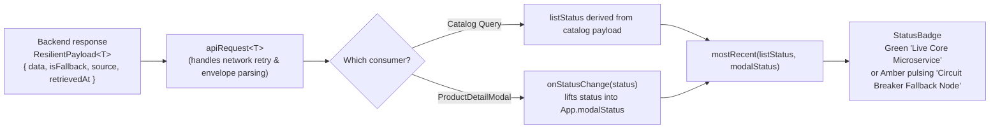

# UI Architecture

`storefront-client` is a single-page React 19 + TypeScript application built with Vite and styled with Vanilla CSS tokens. Routing is managed via a lightweight hash-based URL router (`utils/route.ts` & `App.tsx`) with zero external router dependencies.

## Component Tree & Routing Architecture

```mermaid
flowchart TB
    App["App.tsx<br/>State: route, authSession, activeCart, storeConfig, modalStatus"]
    App --> Header["Header.tsx"]
    Header --> SearchBox["SearchBox.tsx"]
    Header --> StorePicker["StorePicker.tsx"]
    Header --> StatusBadge["StatusBadge.tsx"]
    Header --> CartButton["CartButton"]
    Header -. "role: store-manager / finance / admin" .-> PortalBanner["Workspace Quick Switcher Banners"]

    App --> Router{"Route Switcher (Hash Router)"}
    Router -->|"#shop (default)"| ShopPage["ShopPage.tsx"]
    ShopPage --> Sidebar["Sidebar.tsx (facets)"]
    ShopPage --> DepartmentTiles["DepartmentTiles.tsx"]
    ShopPage --> ProductGrid["ProductGrid"]
    ProductGrid --> ProductCard["ProductCard.tsx"]

    Router -->|"#checkout"| CheckoutPage["CheckoutPage.tsx"]
    CheckoutPage --> PickupSlots["Pickup Slot Selector"]
    CheckoutPage --> ThreeDS["ThreeDSecureDialog.tsx"]

    Router -->|"#order/:id"| OrderPage["OrderPage.tsx (lifecycle & pickup)"]
    Router -->|"#invoices"| InvoicesPage["InvoicesPage.tsx"]
    InvoicesPage --> InvoiceView["InvoiceView.tsx (receipt & credit refunds)"]
    Router -->|"#login"| LoginPage["LoginPage.tsx"]
    Router -->|"#signup"| SignUpPage["SignUpPage.tsx"]
    Router -->|"#account"| AccountPage["AccountPage.tsx (Profile, Addresses, Saved Cards, Data Export)"]
    Router -->|"#setup / #admin"| SetupWizard["SetupWizard.tsx (Region, Stores, First Admin)"]
    Router -->|"#portal"| PortalHub["PortalHub.tsx (Multi-Workspace Hub)"]
    Router -->|"#manager"| ManagerPortal["ManagerPortal.tsx (GRN, CSV, Inventory, Transfers, Adjustments)"]
    Router -->|"#finance / #accounting"| FinancePortal["FinancePortal.tsx (Analytics & Ledger)"]
    FinancePortal --> AnalyticsDashboard["AnalyticsDashboard.tsx (Daily, Trends, Velocity, Margins, Tax)"]
    Router -->|"#telemetry"| TelemetryDashboard["TelemetryDashboard.tsx (MELT, Probes, Chaos)"]

    App --> CartDrawer["CartDrawer.tsx (LRU Cart Sync)"]
    App -. "selectedProductId" .-> ProductDetailModal["ProductDetailModal.tsx"]
```

## Workspaces & Role-Based Portals

| Route | Workspace / Component | Required Role | Capabilities |
|---|---|---|---|
| `#/` or `#/shop` | **Shopper Storefront** (`ShopPage`) | Public / Customer | FTS search, disjunctive facets, cart drawer, unit pricing, SNAP badges. |
| `#/checkout` | **Checkout Flow** (`CheckoutPage`) | Logged-in Customer | Store pickup slots, tax calculation, tokenized card payment, 3DS challenge. |
| `#/account` | **Customer Hub** (`AccountPage`) | Logged-in Customer | Profile edit, address book CRUD, tokenized saved cards, GDPR data export. |
| `#/portal` | **Portal Hub** (`PortalHub`) | `store-manager`, `finance`, `admin` | Unified executive launching pad for operational workspaces. |
| `#/manager` | **Store Operations** (`ManagerPortal`) | `store-manager`, `admin` | Material receipt intake (manual/CSV), batch & expiry logs, stock transfers, WAC costing, shrinkage logging. |
| `#/finance` | **Financial Analytics** (`FinancePortal`) | `finance`, `admin` | Real-time sales trends, pipeline stages, fast/slow SKU velocity, category margins, and state tax ledger. |
| `#/telemetry` | **Telemetry & SRE** (`TelemetryDashboard`) | `admin` / Ops | Live Prometheus metrics, circuit breaker state toggles, health probes, and chaos latency controls. |
| `#/setup` | **Setup Wizard** (`SetupWizard`) | Initial Setup / Admin | Region pack install, tax jurisdiction configuration, initial store seeding, first admin account creation. |

## State Ownership & Data Flow

| State | Owner | Lifecycle & Sync |
|---|---|---|
| `route` | `App.tsx` (via `useHashRoute`) | Derived from `window.location.hash`; changes trigger view rendering. |
| `authSession` | `useAuth` hook | Stored in `localStorage` (`auth_token`); auto-refreshes profile (`GET /api/customers/me`). |
| `activeCart` | `useCart` hook | Stored in `localStorage` (`cart_id`); line items and subtotal synchronized with `product-catalog-service`. On sign-in, anonymous guest cart automatically merges into customer cart (`CUS-05`). |
| `storeConfig` | `App.tsx` | Fetched from `GET /api/store-config`; controls currency formatting, installed payment methods, and store listings. |
| `selectedStoreId`| `App.tsx` / `StorePicker` | Determines tax jurisdiction and store-specific pickup slots during checkout. |
| `modalStatus` | `App.tsx` | Updated via `ProductDetailModal` `onStatusChange` callback. |
| `systemStatus` | Derived | Computed dynamically as `mostRecent(listStatus, modalStatus)` from `retrievedAt` timestamps. |

## Resilience Signal: API Response → UI Badge

The storefront explicitly communicates backend health to the customer and operator through the `StatusBadge` in the header:

The badge keys off `isFallback` / `source` in the `ResilientPayload` response envelope, **never** the HTTP status code alone. In degraded mode, `200 OK` is returned with `source: "circuit-breaker-fallback"`, maintaining unbroken browsing even during database or network outages.

## Type Safety Across the Client/Server Boundary

`storefront-client/src/types/` maintains hand-synced mirrors of `product-catalog-service/src/types/`:
- `product.ts` (`ProductMaster`, `ProductDetail`, `FacetBlock`, `PageResult`)
- `cart.ts` (`Cart`, `LineItem`)
- `order.ts` (`Order`, `OrderLine`, `OrderStatus`, `PickupSlot`, `ReceiptData`)
- `account.ts` (`CustomerProfile`, `Address`, `SavedPaymentMethod`, `CustomerRole`)
- `store.ts` (`StoreConfig`, `StoreLocation`, `PaymentMethodInfo`)
- `receiving.ts` (`GoodsReceipt`, `StoreInventoryRecord`, `StockTransfer`, `StockAdjustment`, `CreateGrnInput`)
- `accounting.ts` (`DailySalesMetric`, `PipelineSummary`, `MonthlyTrend`, `VelocityItem`, `MarginReport`, `RegionalTaxSummary`)
- `observability.ts` (`MetricsSnapshot`, `CircuitBreakerStatus`, `HealthProbeStatus`, `TelemetryEvent`)
